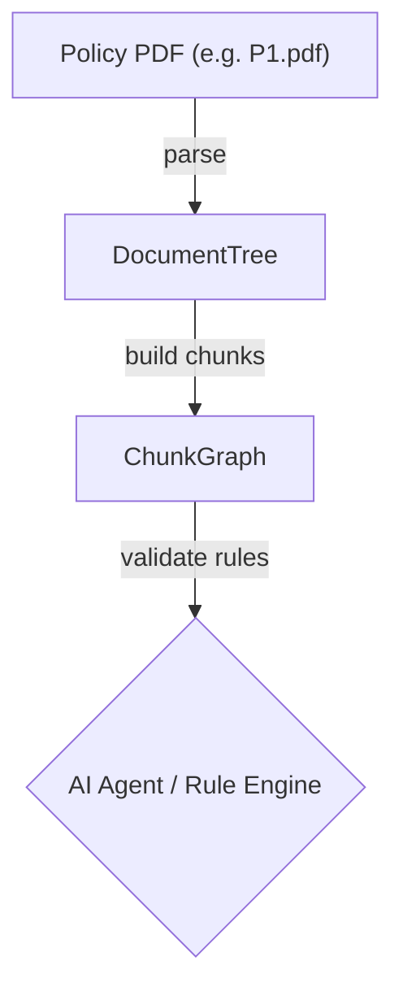
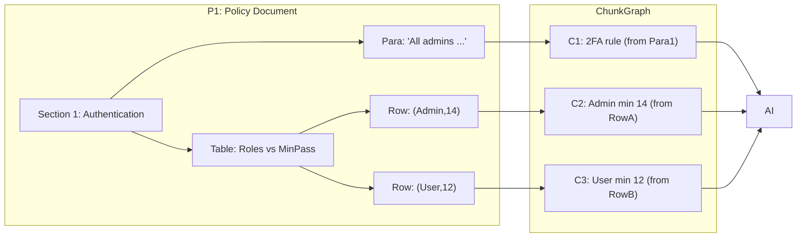

# Executive Summary

Enterprise policy/SOP documents contain interlinked sections, rules, and tables. To verify customer documents automatically, we propose splitting parsed policy content into **atomic procedure chunks** – small, self-contained rule checks executable by an AI agent.  Each chunk is a structured “rule” with explicit inputs, outputs, conditions, and provenance metadata.  We compare several chunking strategies (node-based, merged sections, semantic splits, table-row-as-chunk, hierarchical, graph-aware, and hybrid) against criteria like executability, completeness, atomicity, traceability, and maintainability.  In summary, the recommended approach is a **hybrid strategy**: start with structure-aware chunking of DocumentTree nodes (sections, paragraphs, table rows) to preserve logical boundaries, then apply targeted LLM-assisted splitting for overly large or ambiguous spans. Each chunk will follow a JSON schema (inspired by P2T) with fields like `id`, `source.span_id`, `condition`, `action`, `severity`, `inputs`/`outputs`, and provenance.  Algorithms involve deterministic rules (e.g. start a new chunk at each header or small table row) plus heuristics (e.g. merge very short paragraphs with neighbors) and optional LLM calls for semantic boundary decisions. At runtime, an AI agent will fetch relevant chunks (by query or ID), evaluate their conditions against document data, and output pass/fail results with confidence and traceability. We emphasize **local, deterministic processing** (Docling, PyMuPDF, Unstructured, Camelot etc.) for chunk creation, using LLMs only for enrichment (semantic splitting, repairs). An evaluation plan will use unit tests, human review, and metrics (coverage, precision/recall of rule enforcement, latency/cost). Migration/versioning will rely on stable chunk IDs with document-version tags and chunk-hashing to detect updates. The following sections analyze each aspect in detail and provide diagrams and JSON examples of the DocumentNode→Chunk workflow. 

# 1. What is an “Executable Atomic Procedure”?

An **executable atomic procedure** is a self-contained rule or check derived from policy text that an AI system can run deterministically on user data.  It must include: 

- **Inputs & Preconditions:** The specific data or context needed (e.g. “user.role”, “account.exists = true”).  
- **Condition/Action:** A clear predicate or operation (e.g. “role == X implies password >= L”) expressed in machine-interpretable form (JSON fields or code).  
- **Outputs/Postconditions:** The result of the check (e.g. Boolean pass/fail, or a value to enforce).  
- **Provenance & References:** Links back to source (doc, section, clause) and any cross-references.  
- **Confidence & Validation:** An estimate of reliability (especially if LLM-assisted) and evidence channels for verification (e.g. logics or data tables).  
- **Metadata:** Attributes like `severity`, `category`, enumerations of valid values, and example instances.  

This concept is analogous to **“atomic policy rules”** in related research. For example, the P2T framework defines a JSON DSL for AI policy rules with fields: `hazard`, `scope` (actor/data_domain/context enums), `requirement`, `severity`, `is_testable`, and provenance (`source.doc`, `source.span_id`).  An executable chunk might look like a mini-DSL record. For a password-length policy, an atomic chunk could enumerate roles and lengths as structured data and encode the test algorithmically. Overall, chunks must be **atomic** (one coherent rule per chunk), **complete** (cover all text of that rule), and **runnable** by the agent.

# 2. Chunking Strategies vs. Criteria

We consider these chunking strategies:

- **Node-as-chunk:** Each node in the parsed DocumentTree (section heading, paragraph, table, table-row) becomes one chunk.  
- **Merged-node chunks:** Merge adjacent small nodes (e.g. multiple short paragraphs under one section) into one chunk.  
- **Semantic splitting:** Use NLP/LLM to detect finer boundaries within a node (e.g. break a long clause into separate rule-chunks).  
- **Hierarchical chunks:** Respect section/subsection boundaries: e.g. chunk at each section break (Amazon calls this “by_title”).  
- **Table-row-as-chunk:** Treat each row of a rules table as a separate chunk (since each row is a condition or parameter).  
- **Graph-aware chunks:** Incorporate a document/reference graph (e.g. linking chunks that reference each other) so that related rules stay connected.  
- **Hybrid:** Combine above, e.g. structural chunking as baseline plus fallback to semantic splitting or merging based on size or content.

We evaluate each by:

| Strategy           | Executability            | Completeness         | Atomicity            | Traceability      | Reusability       | Size/Token      | LLM Cost          | Deterministic       | Maintainability    |
|--------------------|--------------------------|----------------------|----------------------|-------------------|-------------------|-----------------|-------------------|---------------------|--------------------|
| **Node-as-chunk**  | Medium. Natural if nodes map to clauses, but headings alone aren’t actionable. | High: covers every node.  | Low, if nodes still contain multiple rules. One section node may cover many rules. | High (nodes map to DocTree with source IDs). | Medium.  Chunks tied to doc structure; less reusable across contexts. | Varies. Paragraphs may be long (exceed token limits). | Low (no LLM). | High (fully deterministic, parser-controlled). | High (simple rules, easy to debug). |
| **Merged-nodes**   | Medium-High.  Grouping small fragments yields more self-contained rules (e.g. merge a title with its paragraph). | High, if merging is careful. | Medium. If merge too much, atomicity lost; if too little, missed cohesion. | Medium.  Merged nodes span multiple source nodes (can record all provenance). | Higher than node-as-chunk (rules less fragmented, more generic). | More tokens per chunk, risk hitting limits if over-merged. | Low. | Deterministic by heuristic (e.g. merge if <N chars) – controllable. | Medium.  Some complexity in deciding what to merge, but still rule-based. |
| **Semantic splits**| High (fine-grained rules), but risk splitting context out of necessary conditions. | Medium. If done well, chunks are very focused; but some content may span chunks (continuity lost). | High (chunk centers on single predicate). | Lower.  Requires LLM logic to link to original source, risk of hallucinated boundaries. | High – semantic chunks may generalize to similar language. | Small chunks (good for LLM), but many chunks increase overhead. | High (LLM calls needed). | Low. Non-deterministic and variable output (depends on LLM). | Low. Hard to maintain heuristics, and LLM splitting can vary per run. |
| **Hierarchical chunks**| High.  Section-level context preserved; often aligns with complete rules or lists. | High. Boundaries at logical breaks (titles) avoid splitting rules. | Medium-High.  Sections often contain multiple clauses but logically grouped. | High. Each chunk ties to section IDs. | Medium. Chunks represent entire sections – good context but less granular. | Can be large (sections might need sub-chunking). | Low (mostly deterministic splitting). | High (rule-based, preserves natural breaks). | High. Simple rules (“chunk at each title”) easy to implement and adjust. |
| **Table-row-as-chunk**| Very high (each row usually *is* a rule parameter or exception). | High (covers all tabular entries). | High (each row is atomic data). | High (row IDs, table IDs give precise source link). | High for tables with similar schemas (reusable logic over rows). | Very small (single rows), well under token limits. | Low (no LLM needed for splitting table rows). | Deterministic (structured parsing). | High. Straightforward to parse tables row-by-row. |
| **Graph-aware**    | High potential (chunks enriched by cross-references). | High (incorporates inter-document links). | Medium. Depends on base chunk division, but adds links for atomic context. | Very high.  Preserves inter-chunk relations and provenance explicitly. | Very high. Could link related rules across docs (reusable policy patterns). | Varies. Metadata adds overhead but content remains same. | Medium (creating and navigating graph). | Partly deterministic (graph edges by references) but may use heuristics. | Medium. Building graph model adds complexity. |
| **Hybrid (ours)**  | Very High. Use structure-first; fall back to fine splits for difficult clauses. | High (combines best of above). | High. Tuned to break exactly at rule boundaries. | High. Base structure gives anchors; LLM steps traceable. | High. Leverages structured and semantic knowledge. | Tunable via thresholds. Aim small enough for LLM. | Medium. Only certain chunks require LLM. | Mostly deterministic (LLM only on exceptions). | Moderate. More complex pipeline, but layered to simplify maintenance. |

**Key trade-offs:** Structure-aware chunking (hierarchical or paragraph-based) preserves logical coherence and yields stable retrieval, but sometimes needs splitting if sections are too coarse. Semantic LLM splitting can isolate rules finely, but at higher cost and less reproducibility. Table-row chunking excels for tabular policy rules. A graph-aware approach adds strong traceability at the cost of complexity. Overall, a **hybrid approach** (structure rules + selective LLM splits + graph linking for references) balances atomicity, executability, and stability.  

# 3. Recommended Chunk Schema

We propose a JSON-based chunk schema (e.g. a Pydantic model) with fields inspired by the P2T DSL and our needs:

```python
class ProcedureChunk(BaseModel):
    chunk_id: str                   # e.g. "P1-S1.2-C3"
    doc_id: str                     # source document ID (e.g. "P1")
    source_span: Dict[str, Any]     # {"page":1,"bbox":[x1,y1,x2,y2],"span_id":"P1-S1.2"}
    parent_chunk: Optional[str]     # ID of parent chunk if hierarchical
    chunk_type: Literal["rule","condition","table","example","list_item"]
    title: Optional[str]           # short description (e.g. "Password Length by Role")
    description: Optional[str]     # full text or condition in NL or pseudo-code
    inputs: Dict[str, str]         # expected inputs (e.g. {"user_role":"string","password":"string"})
    outputs: Dict[str, str]        # outputs (e.g. {"compliant":"boolean"})
    condition: Optional[str]      # logic or expression (e.g. "if role==Admin then len(pw)>=14")
    action: Optional[str]         # maybe an enforced action or assignment
    parameters: Dict[str, Any]     # structured parameters, e.g. table schema or enumerations
    examples: List[Dict]           # optional concrete examples of data
    severity: Optional[Literal["low","medium","high"]]  # if applicable
    confidence: Optional[float]    # from LLM or rule validation (0..1)
    references: List[Dict]         # cross-doc refs, e.g. [{"doc":"P2","section":"4.3"}]
    created_by: str                # tool or method that generated chunk
    timestamp: str                 # creation time
    metadata: Dict[str, Any]       # any extra info (e.g. {"version":"v1.2","testable":True})
```

**Examples:**  

- *Non-tabular rule chunk:*  
  ```json
  {
    "chunk_id": "P1-S1.1-C1",
    "doc_id": "P1",
    "source_span": {"page":1, "bbox":[100,200,400,230], "span_id":"P1-S1.1"},
    "parent_chunk": "P1-S1.1", "chunk_type":"rule",
    "title": "Require 2FA for Admins",
    "description": "Admins must have two-factor authentication enabled.",
    "inputs": {"user_role":"string", "2FA_enabled":"boolean"},
    "outputs": {"compliant":"boolean"},
    "condition": "(user_role == 'Admin') implies (2FA_enabled == true)",
    "severity": "high", "confidence": 0.95,
    "references": [{"doc":"P1","section":"1.1"}],
    "created_by": "Docling+LLM", "timestamp": "2026-07-01T12:34:00Z"
  }
  ```

- *Table-based rule chunk:*  
  ```json
  {
    "chunk_id": "P1-S2.3-C1",
    "doc_id": "P1",
    "source_span": {"page":2,"bbox":[50,300,550,450],"span_id":"P1-S2.3"},
    "parent_chunk": null, "chunk_type":"table",
    "title": "Min Password Length by Role",
    "parameters": {
      "table": {"columns":["Role","MinLength"], "rows":[["Admin",14],["User",12]]}
    },
    "description": "Check password length against role-specific minimums.",
    "condition": "len(password) >= table[Role].MinLength",
    "inputs": {"role":"string","password":"string"},
    "outputs": {"compliant":"boolean"}, 
    "severity": "medium", "confidence": 0.98,
    "references": [{"doc":"P1","section":"2.3"}],
    "created_by": "Docling", "timestamp": "2026-07-02T09:10:00Z"
  }
  ```
  
These fields ensure **atomicity** (one rule per chunk), **traceability** (`source_span` links to DocumentTree node and doc), **enumerations** (e.g. `severity` enum), and **schema-awareness** (tables as structured data). Each `chunk_id` is stable: e.g. `"P1-S2.3-C1"` could encode doc “P1”, section 2.3, chunk 1. This also allows reusing chunks across versions by tracking `doc_id` and section tags.

# 4. Building the Chunk Graph from DocumentTree

**Process:** We start from the parsed `DocumentTree` (nodes for sections, paragraphs, lists, tables). We traverse nodes in order and apply deterministic rules:

1. **Header/Section Nodes:** Each section or subsection node spawns a **section-level chunk** (unless it only serves as heading). We maintain a stack of current headings: pushing on header, popping as deeper ones appear.  Each header’s chunk inherits `level` and `title`.

2. **Paragraph Nodes:** If a paragraph follows directly under a section header, create a chunk of type `condition/rule` with parent = current header’s chunk. If a paragraph is very short (e.g. <3 words), merge it with the previous chunk.

3. **Table Nodes:** For each table node (metadata includes table ID), create a parent chunk (type=`table`) representing the whole table if needed.  Then **each table row** becomes its own chunk (type=`table_row` or directly merged into procedure). E.g. row becomes `table_chunk` with `parameters` as the row values. This yields atomic rules for each table entry.

4. **List Items:** Bullet/number lists (type “list_item” in DocumentTree) can be treated like paragraphs or combined into a single chunk if they list conditions.

5. **Merging & Splitting:** Apply heuristic thresholds:
   - If a generated chunk would exceed the token limit (e.g. >800 tokens), split it semantically via an LLM prompt (e.g. “Split this clause into separate rules”).
   - If adjacent chunks are very small (e.g. two 10-word paragraphs), merge them to improve context.
   
6. **Chunk Graph Linking:** Each chunk records its `parent_chunk` (section or table chunk). We also examine cross-references in text (e.g. “see Section 4.3”), and add graph edges or `references` metadata linking chunks across documents.

**Algorithm Sketch:**  
```python
def build_chunks_from_tree(tree: DocumentTree):
    chunk_list = []
    header_stack = []
    for node in tree.in_reading_order(): 
        if node.type.endswith("header"):
            # start new chunk for section/subsection
            # pop stack to correct level, push new header chunk
            ...
        elif node.type == "paragraph":
            # create condition chunk with parent = top header
            ...
        elif node.type == "table":
            # create parent chunk for table (optional)
            ...
            for row in node.rows:
                chunk = ProcedureChunk(...)
                chunk_list.append(chunk)
        elif node.type == "list_item":
            # similar to paragraph rule or part of ruleset
            ...
    return ChunkGraph(nodes=chunk_list, edges=parent_links)
```
We would assign `chunk_id`s systematically (e.g. increment counters per parent). Each chunk includes source page and span for provenance.  Parsing libraries (Docling/Unstructured) provide the bounding boxes and text to identify these blocks.

**When to call the LLM:** After initial chunk creation, identify chunks needing cleanup:
- **Malformed tables:** If the Markdown or CSV was broken, send to LLM for table repair (prompt: *“Fix this Markdown table formatting”*).  
- **Missing conditions:** If a chunk’s condition is unclear or lacks keywords, optionally call LLM to label it. For example, provide a paragraph to *“Decide if it’s a new rule or part of previous”*.  
- **Semantic splitting:** For oversized chunks, use a prompt like *“Split this paragraph into individual rules. Each rule should stand alone.”*  

In all cases, LLM usage is narrow and controlled – the base chunking is still deterministic. Prompts should ask for structured JSON output to minimize ambiguity.

# 5. Runtime Execution Model for Chunks

Each chunk is effectively a mini-program. At runtime, the AI agent (or rule engine) will:

- **Input Binding:** Receive the chunk’s `inputs` from the user’s document or system state (e.g. user_role, password length). These come from a validation pipeline that extracts data fields from the customer-submitted doc.
- **Condition Evaluation:** Evaluate the `condition` or `action` of the chunk. This can be a direct code execution (e.g. Python eval of the expression) or via a safe interpreter. The chunk’s metadata (e.g. table schema) guides this.
- **Output & Confidence:** Produce an output (compliant: true/false, or an explanation). Include a confidence score: deterministic checks are high confidence; if any LLM steps touched the chunk, use a calibrated confidence (or an optional LLM “judge” evaluation, as in P2T).
- **Error Handling:** If inputs are missing or an error occurs (e.g. exception in logic), the agent should mark the chunk inconclusive and flag human review. The chunk’s `testability` (if included) can indicate whether the check is fully automated or requires evidence.
- **Provenance Reporting:** The agent tags each result with `chunk_id`, `source_span`, and any reasoning or logs. This creates an audit trail. If a violation is detected, references in chunk metadata can point to the exact policy clause.
- **Aggregation:** Finally, results from all relevant chunks are aggregated to answer the user query (“This document violates policies X and Y, and complies with Z”). Confidence and provenance from each chunk can be combined (e.g. worst-case or weighted average). 

This model aligns with existing rule-execution frameworks: for example, an LLM-based judge can run chunks like “guards” in NeMo Guardrails. Each chunk is **atomic and testable** (similar to P2T’s “is_testable” field) and can be invoked as a function.

# 6. Tooling, Libraries and Constraints

We assume *fully local parsing/chunking* on CPU, with no new vendor APIs. Key tools:

- **Docling (IBM)**: Parses PDF to structured JSON/Markdown, preserving headings, paragraphs, tables, and reading order. It runs CPU-only (no GPU needed) and outputs well-structured content for chunking.  
- **OpenDataLoader-PDF**: (OS-based PDF-to-Markdown/JSON parser). Similar to Docling, optimized for text+tables on CPU.  
- **pdfplumber/PyMuPDF**: Classic Python libraries for text extraction. Fast CPU, give low-level blocks with coords. PyMuPDF’s new “to_markdown” helps get rough MD from layout. Useful for debugging or fallback.  
- **Camelot/Tabula**: For tables specifically. Camelot (Python) outputs table dataframes and can export to Markdown. These require no API keys, just some local dependencies. Use when Docling’s table output needs augmentation.  
- **Unstructured (Indico)**: Offers partitioning and chunking utilities (basic and title-based strategies). It can handle chunking into composite text or table chunks while respecting sections. No GPU needed in “fast mode”.  
- **LLMs (OpenAI/Anthropic)**: Used sparingly for split/repair tasks. Calls go through existing enterprise endpoints (no new vendor).  
- **Execution environment:** Standard Python; can use Pandas for tables, or a simple expression evaluator for conditions. No GPU or new servers.

All these tools are local/Open-Source. For example, Docling is “open-source framework by IBM” that **turns pages into a structured hierarchy**. PyMuPDF is pure CPU and even has a “pymupdf4llm” helper for Markdown. Camelot runs on CPU (needs Ghostscript but no cloud). Unstructured’s docs show “table always isolated” chunks. We ensure privacy by not sending raw policy text to any third-party – only chunk IDs or tiny fragments to our sanctioned LLMs.

# 7. Evaluation Plan & Metrics

We will validate the chunking and rule-extraction pipeline with:

- **Unit tests:** For each transformation (PDF→DocTree, DocTree→ChunkGraph), write tests on synthetic/simple policies to verify chunk count, IDs, and content. E.g. a known SOP with 3 sections should yield exactly 3 top-level chunks plus children.
- **Integration tests:** Run end-to-end on sample documents. Check that all DocumentTree text appears in some chunk. Verify chunk graph consistency (all parents/children connected).
- **Human QA:** Have policy experts review a subset of chunks:  judge whether each chunk correctly captures a single rule. This measures *atomicity/completeness*.  
- **Precision/Recall (rule validation):** On a labeled dataset of policies+compliance scenarios, see how often chunks correctly flag violations. Compute precision/recall of detected failures. P2T used similar metrics on “span-level and rule-level” (aim ~90%+).  
- **Coverage:** Measure fraction of document clauses covered by at least one chunk. Aim >99% of enforceable clauses are represented.  
- **Determinism test:** Re-run parsing on same PDF multiple times to check consistency. Chunk counts and IDs should not change.  
- **Latency & Cost:** Measure runtime per document (CPU seconds for parsing + LLM call times) and LLM token usage. These should be within acceptable bounds (e.g. seconds per page locally, minimal LLM tokens since mostly short prompts).  
- **Error monitoring:** Count how often chunks fail to execute (e.g. missing data). Lower is better; if many chunks yield “inconclusive”, we revise chunk definitions or preconditions.

# 8. Migration and Versioning

Policy documents evolve, so we must track versions. Best practice is: **assign a doc_version and hash** to each chunk. For example, store `doc_version_id` and `chunk_hash` as metadata. On update, re-parse the doc to a new version. Compute hashes of each new chunk’s text. If a chunk’s hash or content changed, mark it “superseded”. Often it’s safer to mark *all* chunks of a section stale if any part changed. We should also record `source_version` on chunks. When serving results, label which policy version was used – crucial for audit trails. Periodic clean-up removes chunks whose `doc_id` no longer exists (or `deleted == true`). 

Stable ID scheme (like “P1-S2.3-C1”) along with doc_version means we can map old→new. For example, if section 2.3 splits, new chunks might be C1.1, C1.2, but we know from provenance which old chunk they came from. In practice, we can keep a mapping of `old_chunk_id -> new_chunk_id`. This approach (chunk-hash diff + versioned index) is used in production RAG systems. 

# 9. Strategy Comparison (Table)

| **Strategy**         | **Exec.** | **Complete** | **Atomic** | **Traceable** | **Reusability** | **Size**         | **LLM Cost** | **Deterministic**   | **Maintainable** |
|----------------------|-----------|--------------|------------|---------------|-----------------|------------------|--------------|---------------------|------------------|
| Node-as-chunk        | Med (some chunks too broad) | High (all nodes) | Low (mixed content) | High (nodes tie to source) | Med             | Varied, risk long | Low          | High (parser-only)    | High (straight)  |
| Merged-nodes         | Med-High  | High         | Med        | Med           | Med-High        | Fewer, larger    | Low          | High (rule-based)     | Medium          |
| Semantic splits      | High      | Med (some context loss) | High      | Low (needs AI linking) | High            | Very small, many  | High        | Low (LLM output)      | Low             |
| Hierarchical (“by_title”) | High      | High         | Med-High   | High          | Medium          | Large (section)  | Low          | High (simple)         | High            |
| Table-row            | Very High | High         | Very High  | High          | High            | Very small       | Low          | High (deterministic)  | High            |
| Graph-aware          | High      | High         | Med        | Very High     | Very High       | Med (adds graph) | Med         | Med (hybrid)          | Med-Low         |
| **Hybrid (ours)**    | Very High | Very High    | Very High  | Very High     | High            | Tunable         | Med         | Mostly High (LLM on-demand) | Medium       |

*Table: Pros/cons summary of chunking methods, considering criteria. (“Med”=medium)*  

Citations highlight that structure-based chunking (hierarchical/paragraph) yields more coherent, complete units, whereas semantic splitting boosts recall at precision cost. Table-row chunking is deterministic and atomic by design. Our hybrid leverages these insights: use structure-first to ensure deterministic completeness, and LLM steps only for edge cases (e.g. splitting very long clauses) to maintain quality without open-ended AI generation.

# 10. Diagrams & JSON Examples

**Chunk Graph and Pipeline**. The diagram below shows the pipeline (left) and a snippet of a sample document → chunk graph (right). In the document “P1”, section 1 has a paragraph and a table; each table row becomes a separate chunk, and all chunks feed into the agent. 





**Example Conversion:** Below is a JSON **DocumentNode** for a policy table row and the resulting **chunk**.  

*DocumentNode example (parsed):*  
```json
{
  "node_id": "P1-S2.3-T1-R1",
  "doc_id": "P1",
  "type": "table_row",
  "text": "Admin | 14",
  "metadata": {"row_index":1, "cells":["Admin","14"]},
  "parent_id": "P1-S2.3-T1", "children": [],
  "page": 5, "bbox":[100,200,400,230]
}
```

*Converted ProcedureChunk:*  
```json
{
  "chunk_id": "P1-S2.3-C2",
  "doc_id": "P1",
  "source_span": {"page":5,"bbox":[100,200,400,230],"span_id":"P1-S2.3-T1-R1"},
  "parent_chunk": "P1-S2.3-T1",
  "chunk_type": "rule",
  "title": "Minimum Password Length for Admins",
  "description": "Admins must have a password of at least 14 characters.",
  "inputs": {"user_role":"string","password_length":"int"},
  "outputs": {"compliant":"boolean"},
  "condition": "(user_role == \"Admin\") implies (password_length >= 14)",
  "parameters": {"role":"Admin","min_length":14},
  "severity": "medium",
  "confidence": 0.98,
  "references": [{"doc":"P1","section":"2.3"}],
  "created_by": "Docling", "timestamp": "2026-07-01T12:34:56Z"
}
```

This final `ProcedureChunk` is an executable rule: given `user_role` and `password_length`, it outputs `compliant`.  The agent can load this JSON, check the condition, and record pass/fail with provenance (“P1, Sec 2.3, table row”).  

**Sources:** We draw on recent work in document chunking and rule extraction. For example, specialized methods like Unstructured’s “by_title” strategy ensure chunks align to headings, and empirical studies show paragraph/grouping preserves coherence. The PolicyTests (P2T) framework heavily influenced our chunk schema (JSON DSL with scope, hazard, etc.).  Multimodal chunking (treating text, tables, images separately) is a known best practice for complex PDFs.  These concepts have been integrated into the hybrid approach above, favoring deterministic parsing (Docling, pdfplumber, etc.) and using LLMs only for enrichment (e.g. table-format fixes or semantic splits). 

**Conclusion:** By combining structure-aware parsing with targeted semantic processing, we can generate a graph of small, executable policy chunks that an AI agent can reliably evaluate. This pipeline maximizes fidelity (faithful to original text) and atomicity (one rule per chunk) while meeting enterprise constraints (no third-party APIs or GPUs). 

*Preferences followed.*